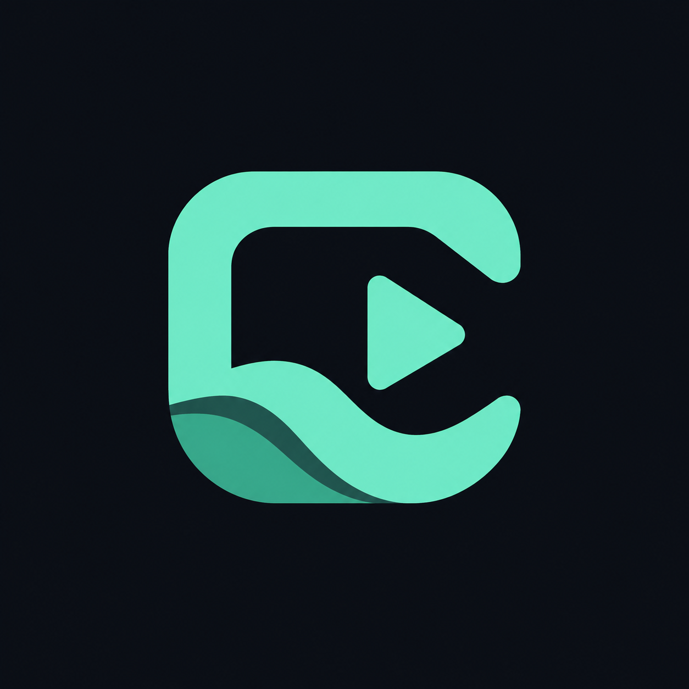
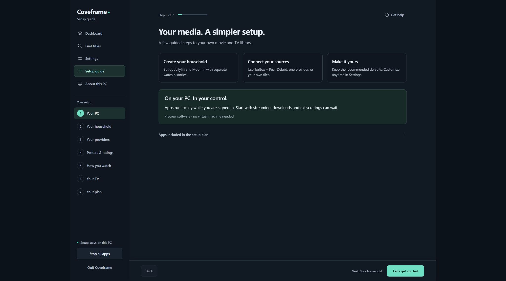
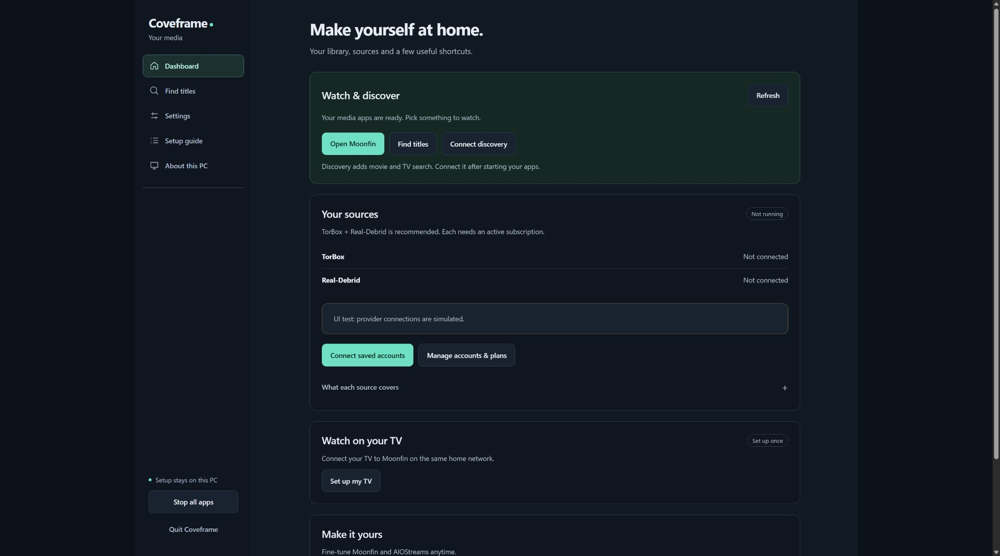

# Coveframe



A local Windows web wizard for Jellyfin, Moonfin and connected media apps.

**Public beta.** The wizard guides streaming, optional downloads and home TV setup. Physical-TV playback, complete provider/download qualification and software updates still need verification. Boot testing stays deferred. Read the [release notes](RELEASE-NOTES.md) first.

## Start here

1. Download the Windows x64 ZIP from [Releases](https://github.com/Coveframe/coveframe/releases), verify its accompanying SHA-256 and extract the whole folder.
2. Open **Coveframe.exe**. Your browser opens the local setup wizard.
3. Create your household. Setup downloads separate Jellyfin and Moonbase packages, about 275 MB. AIOStreams and Seerr are included in the ZIP.
4. Keep **TorBox + Real-Debrid** selected. Start with **TorBox Essential + Real-Debrid Premium**; choose TorBox Pro if you want its Usenet features. The wizard links to subscriptions and API-key pages. Selecting a tier does not purchase or change a subscription.
5. Connect your accounts and open Moonfin. Basic posters need no personal API key. Optional ratings keys and downloads can wait.
6. For your TV, open **Your TV**. Scan your trusted Private home network, review **Enable TV access**, then follow the Moonfin steps. The small **Get help** button on any setup step opens a current-progress prompt for Codex, without passwords or API keys. See the [TV guide](docs/TV-SETUP.md).

Basic PC setup needs no administrator rights, VM, Docker, separate Node installation or Windows service. Optional TV access may ask Windows administrator permission for one restricted firewall rule. This beta is unsigned. Follow your normal Windows trust decisions; do not disable antivirus or bypass Windows protection. The complete source is available to inspect or run yourself.

## A look inside

Shown with simulated demo data. Screenshots demonstrate the interface, not verified playback. The small **Get help** button opens a current-progress prompt on every setup step in the beta download.





[See the Codex help dialog](assets/screenshots/codex-help.png). It refreshes on open and before copying, with no API keys or passwords. Close it or press Escape to return to setup.

## Customize later

**Settings** saves Moonfin banner rotation, trailers and theme music, plus AIOStreams resolution, ordering and quality choices. Restore defaults resets that section while keeping account connections. Reload Moonfin after saving. More themes and home-screen choices are in Moonfin's own Settings.

**Find titles** adds streaming links. Playing a link checks cached availability. Optional automatic downloads set up Radarr, Sonarr, Prowlarr and Decypharr, about 435 MB plus space for media. Use both providers or choose one. The public Knaben indexer is configured automatically; no extra indexer subscription is required. Downloads require an explicit request.

## What runs and where

The launcher includes Node.js, AIOStreams and Seerr. Setup downloads checksum-pinned official packages only after you choose the corresponding action. See [third-party software](THIRD-PARTY.md) and the [package manifest](src/media-packages.mjs).

- Data, encrypted accounts, private configuration and caches: `%LOCALAPPDATA%\MediaHub\Setup`. The MediaHub name is retained for compatibility.
- Streaming library: `Media\Library` inside that data folder.
- Downloaded media: `DownloadApps\Files`, or the local folder you select.
- The extracted launcher stays wherever you put it. About this PC displays your exact paths.

PC apps bind to `127.0.0.1`: wizard 18797, Jellyfin/Moonfin 18798, AIOStreams 18800, playback gateway 18801, Seerr 18802, Radarr 18803, Sonarr 18804, Prowlarr 18805, Decypharr 18806 and the local provider bridge 18807. Optional TV access shares only the media connection on your selected Private home address, port 18799; it does not expose the wizard or provider controls. Closing a browser tab leaves apps running. **Stop all apps** keeps the dashboard open. **Quit Coveframe** closes the wizard too. No automatic startup is added.

**Uninstall**, in About this PC, stops the apps and removes downloaded software, databases, profiles, settings and saved keys. It keeps media and streaming library files. Confirm removal, close the tab, then delete the extracted launcher folder. Existing media installations are not adopted or changed.

## Privacy

Saved credentials use Windows DPAPI for your Windows user. Connected apps also require private local databases/configuration that may contain credentials. Runtime folders are restricted to your Windows user. Coveframe diagnostics do not print account keys or raw provider responses. AIOStreams sensitive logging is disabled and discovery logging is reduced. Vendor logs and playback links must still be treated as private. Never upload the data directory as a bug report.

Coveframe has no account or telemetry server. Providers, metadata services and the indexer receive requests needed for their features. Keys are excluded from exported plans and release packages. Disconnect removes the local saved key; revoke it at the provider. Do not distribute a personal metadata API key as a shared project key.

## Run from source

Use Windows x64 and Node.js 24 or later:

```powershell
node --test test/*.test.mjs
node bin/start-local.mjs
```

Open `http://127.0.0.1:18797` after it starts. No dependency install is needed for the wizard. AIOStreams and Seerr packages must be built with their scripts or copied from the release's `packages/` directory; hashes must match the manifest. Prepare those verified bundles under `artifacts/` and run `node scripts/build-portable.mjs` to build a portable ZIP. Build scripts stop if output already exists and never include a local data directory.

The original isolated qualification tools remain developer tools; boot qualification is deferred. Coveframe's code is [MIT licensed](LICENSE). Separate applications retain their licenses.

## Updating Coveframe

Choose **Quit Coveframe**, extract the new release into a new folder, then open its launcher. Keep the existing data folder to retain accounts and preferences. Keep your old release folder until the new one works. Coordinated vendor-app upgrades and downgrade recovery are not yet qualified; do not run two releases together.
